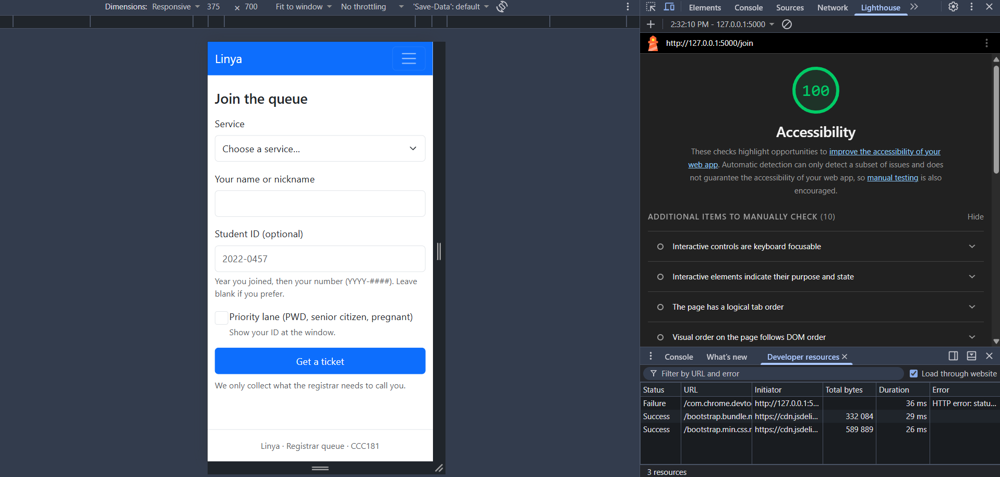
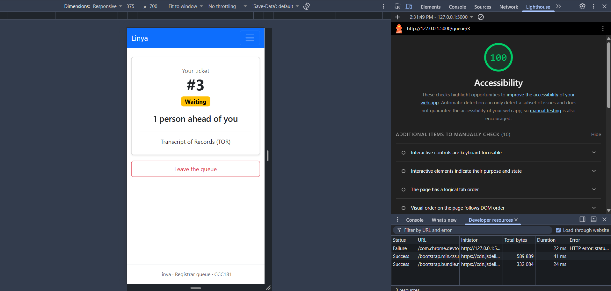
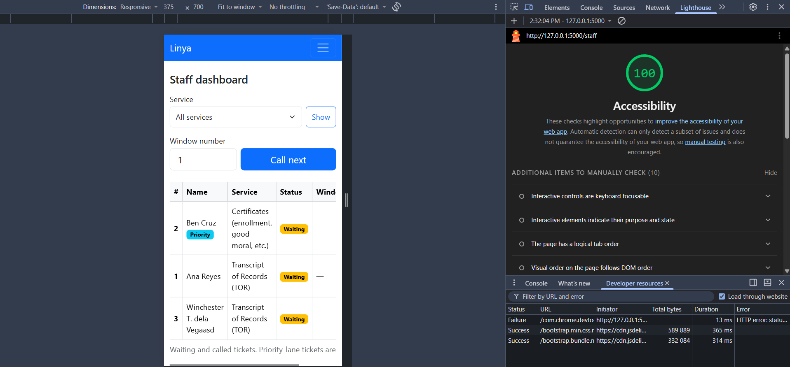

# Accessibility check

## 9a. Lighthouse (Mobile, Accessibility)

| Screen | Score | Screenshot |
| --- | --- | --- |
| Join | [ 100 ] |  |
| My place | [ 100 ] |  |
| Staff dashboard | [ 100 ] |  |

## 9b. Keyboard-only test

- Join the queue: Everything works but when pressing Enter in the priority lane checkmark, it would automatically goes to get a ticket... (click space instead to check)
- Staff dashboard (filter, call, serve): Everything works... for now
- Skip link on first Tab: yes
- Focus always visible: no,, no focus visible when in the Join the queue or Staff in the upper right corner... 

## 9c. Manual checklist

| Check | Join | My place | Staff |
| --- | --- | --- | --- |
| Every input has a visible label | ✅ | N/A | ✅ |
| Error messages say what to do, in text | ✅ | N/A | ✅ |
| Status shown in words, not only color | ✅ | ✅ | ✅ |
| Readable at 375 px, no sideways page scroll | ✅ | ✅ | Table Goes Sideways |
| Buttons about 44 × 44 px | ✅ | ✅ | ✅ |
| One h1 and headings in order | ✅ | ✅ | ✅ |
| html lang is set | ✅ | ✅ | ✅ |