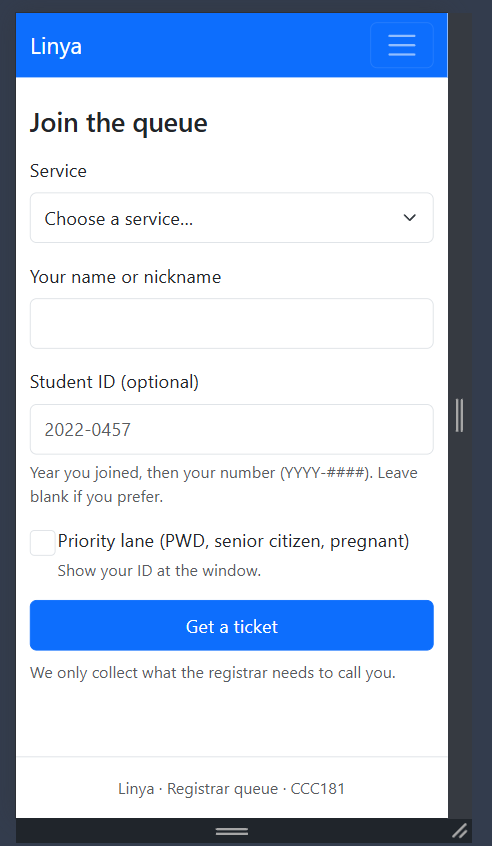
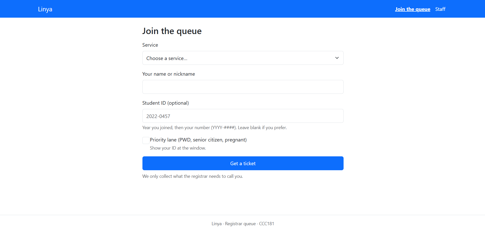
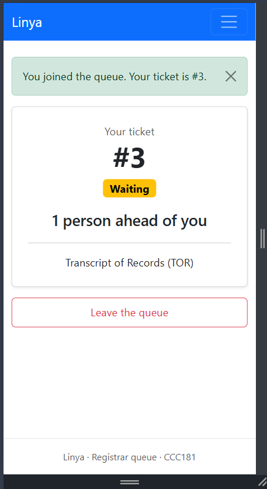
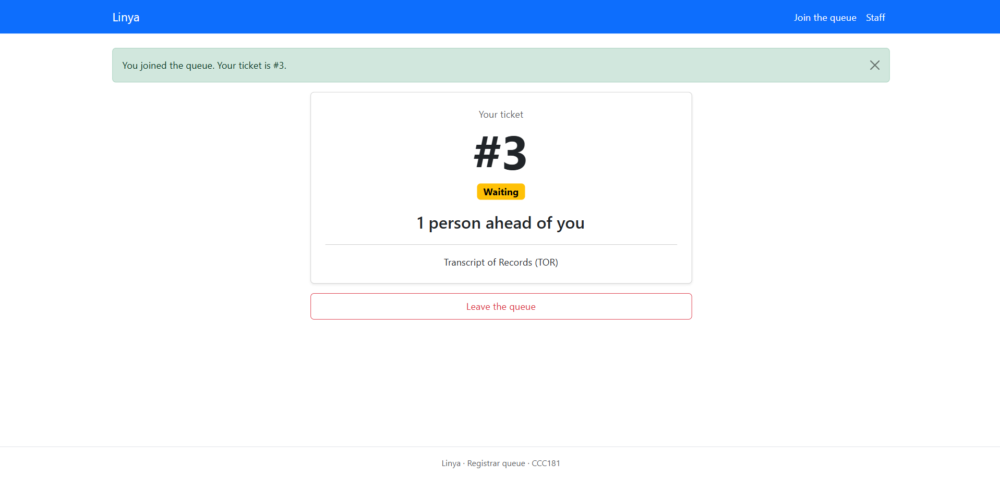
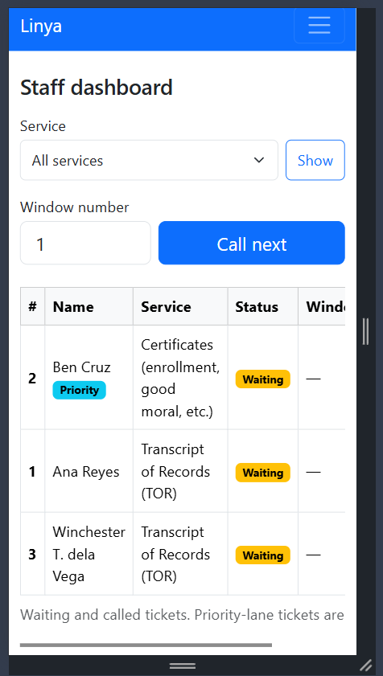
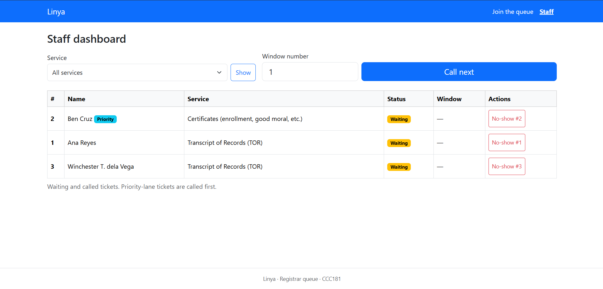

# Linya: Week 3 report

## 1. Title details

| | |
| --- | --- |
| **App** | Linya, a queue system for the campus registrar |
| **Setting** | Campus registrar (Transcript of Records and other requests) |
| **Student** | Winchester Dela Vega |
| **Student ID** | 2024-0673  |
| **Section** | [  ] |
| **Date** | October 25, 2026 |
| **Pull request** | https://github.com/AikawaKun9/Linya/pull/2 |

## 2. Personas

**Eddie, the student waiting.** "Unsay purpose sa mga lingkoranan kung magbarog raman diay japon ta para molinya." Top tasks: join the queue (FR-01), check number and people ahead (FR-02), see the status change without refreshing (FR-04), see which window to go to (FR-08 ★), leave the queue (FR-10).

**Ms. Elena, the registrar counter staff.** [Quote, or "No direct staff quote yet; this persona is based on my observation and what students told me."] Top tasks: view the waiting list by service (FR-09), call the next student and mark served or no-show (FR-03), set the window number (FR-08 ★).

Full personas: [docs/week3/personas.md](personas.md)

## 3. Screens

| Screen | Phone | Laptop |
| --- | --- | --- |
| Join |  |  |
| My place |  |  |
| Staff dashboard |  |  |

- **Join:** used by Eddie. Covers FR-01.
- **My place:** used by Eddie. Covers FR-02, FR-04, FR-08 ★, FR-10.
- **Staff dashboard:** used by Ms. Elena. Covers FR-03, FR-08 ★, FR-09.

## 4. Design decisions

1. **The ticket number is the biggest thing on My place**, with a status badge in words and "N people ahead" underneath, because the waiting student in my research stays near the counter without knowing the queue, and Eddie only glances at his phone from a bench.
2. **Staff enter a window number when calling, and the student sees "Go to Window N".** Students waited with no information, so the screen now tells them where to go.
3. **Student ID is optional (YYYY-####) and Email was removed.** My Week 1 proposal promises to collect only the minimum data (RA 10173), and the app never used the email.
4. **Tickets can only be called through "Call next", with priority-lane tickets first,** which keeps the queue fair and stops staff calling students out of order.

## 5. Self-review

I reviewed each screen at phone and laptop width against my personas, Eddie and Ms. Elena, and their "Because..., my interface must..." rules. The wireframes in `wireframes/` show my first design. I made the changes below directly in the build, so the final screens are in section 3.

**Join:** the first design asked for more than Eddie needs. The Email field was never used, Student ID looked required and had no format hint, and Service, the reason he came, was the fourth field. This went against my Week 1 promise to collect only the minimum data (RA 10173) and against match with the real world and error prevention. I removed Email, made Student ID optional with the hint "your number (YYYY-####)", moved Service to the first field, and added a short privacy line under the button.

**My place:** the large ticket number and "people ahead" worked well for someone who only glances at a phone. The problem was "Leave the queue", which looked like a normal action, so one careless tap could cost Eddie his place after hours of waiting. I made it a red outline button and added a confirmation ("Leave the queue? You will lose your place."). I also noticed my Week 1 requirement FR-02 promises an estimated wait, which the frames don't show. I left it out this week, because a good estimate needs stored service times, which a database can hold from Week 4.

**Staff dashboard:** "Call next" was the right size and in the right place, but the frames also had a "Call" button on every row, so staff could call students out of order. This conflicts with the fair, first-come order with priority-lane tickets first. I removed the per-row Call buttons, so tickets are called only through Call next, and made Serve a solid green button and No-show a red outline. I added a Window column and a Priority badge. On the phone, the Actions column still needs sideways scrolling. I kept that on purpose, because Ms. Elena works on a desktop PC and Call next stays above the table.

Full review: [feedback.md](feedback.md)

## 6. Accessibility

Lighthouse accessibility scores: Join 100, My place 100, Staff dashboard 100.

The most important issue I fixed was keyboard focus. In my keyboard-only test, the navbar links showed no visible focus when I tabbed to them, so a keyboard user could not tell where they were. I added a clear focus outline for links, buttons and form fields in `style.css`. I also made the navbar links white for contrast and the current page's link bold and underlined, made buttons and fields at least 44 px tall for phone taps, and gave each Serve and No-show button a label that names its ticket, since a screen reader would otherwise hear many identical buttons.

The keyboard test also showed that pressing Enter on the priority checkbox submits the form. This is normal browser behavior (Space toggles a checkbox, Enter submits), so I left it as it is.

Full notes: [accessibility.md](accessibility.md)

## 7. Usability test

The participant was my aunt who works at the accounting center in Baranggay

| Task | Result |
| --- | --- |
| 1. Join the queue | All good |
| 2. Find position and number | A moment of silence,, |
| 3. Call next and serve as staff | Confused on the window panel |

## 8. Reflection

**Hardest this week:** It is getting the staff and student pages to stay in sync, and fixing bugs like the typos inside the codes and the mismatched element id, mixed with the ticking of the clock,, racing against time,, yess it was hard... 

**What changes in Week 4 (PostgreSQL):** tickets now live in a Python list, so they disappear whenever the server restarts. A database will keep them. The ticket number is currently "last number plus one", which could repeat when two people join at once, so the database should assign it. The staff and My place pages should read from tables instead of loops over a list, and an estimated wait time (FR-02) will need stored service times. QR join (FR-01) and staff login are also still to do.

## 9. Declaration

I used Claude (an AI assistant) to help plan the steps, draft persona and wireframe layouts, review my design, and help write and debug the Flask, Jinja and JavaScript code. The research, the decisions, the testing and the final edits are my own.