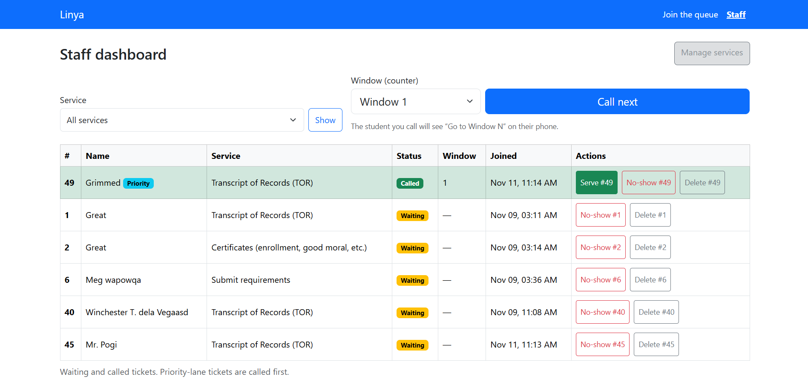
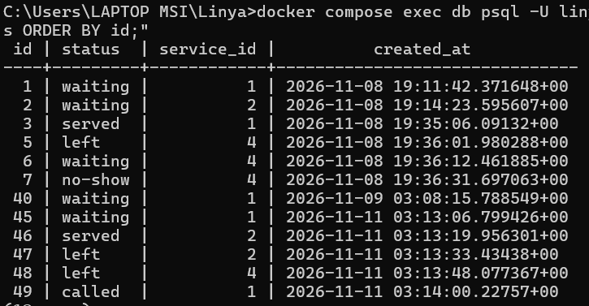
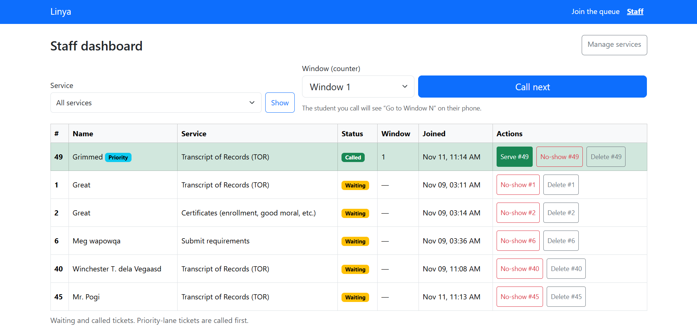
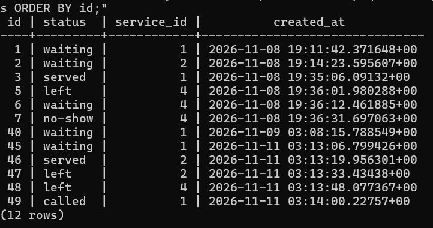

# Persistence proof

## Restart test (NFR-05)

1. I created [N] tickets across [2 or more] services, called one, served one, and let one leave.
2. Before the restart:

   
   

3. I stopped Flask with Ctrl+C, ran `docker compose down`, and `docker compose ps` showed nothing running.
4. I ran `docker compose up -d`, waited until the database was healthy, and started Flask again.
5. After the restart:

   
   

**Result:** every ticket, status and time was the same as before the restart. [NFR-05 passed.]

The dashboard only lists waiting and called tickets, so the SQL query is what shows that served and left tickets are also still there.

## Rebuild from scratch

I ran `docker compose down -v`, `docker compose up -d`, `flask db upgrade` and `flask seed`. The database was rebuilt from my two migrations, the seed added my services and windows, and the app let me join the queue. It works  