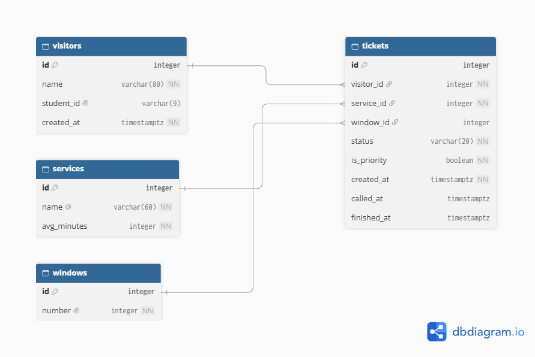
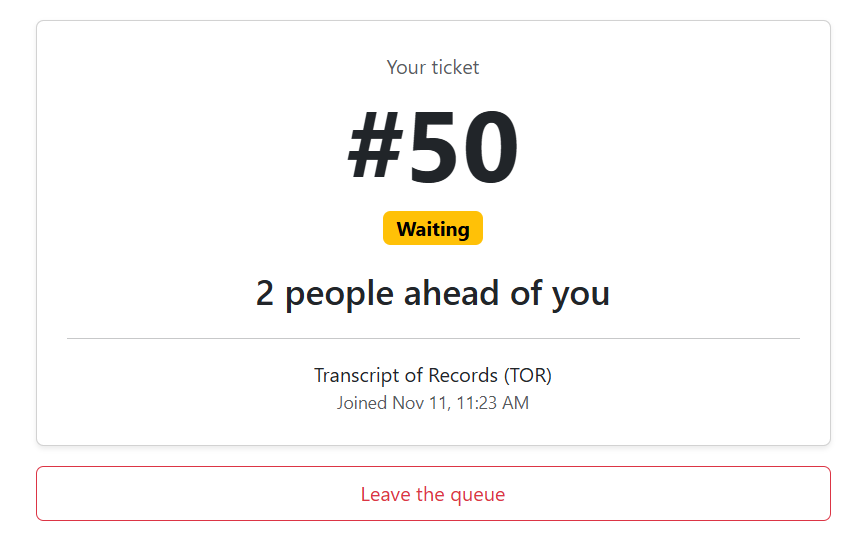
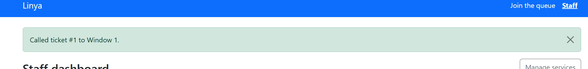
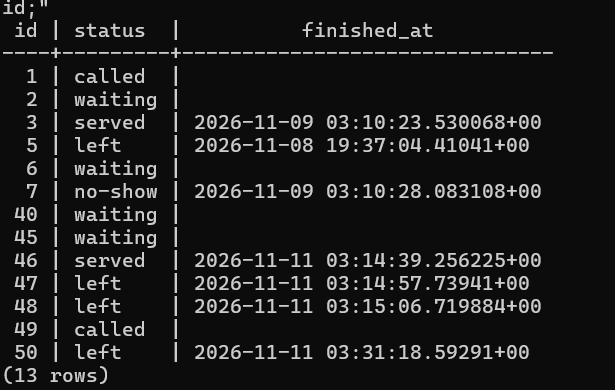
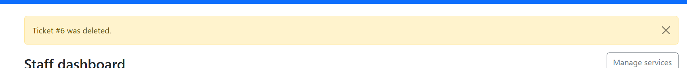
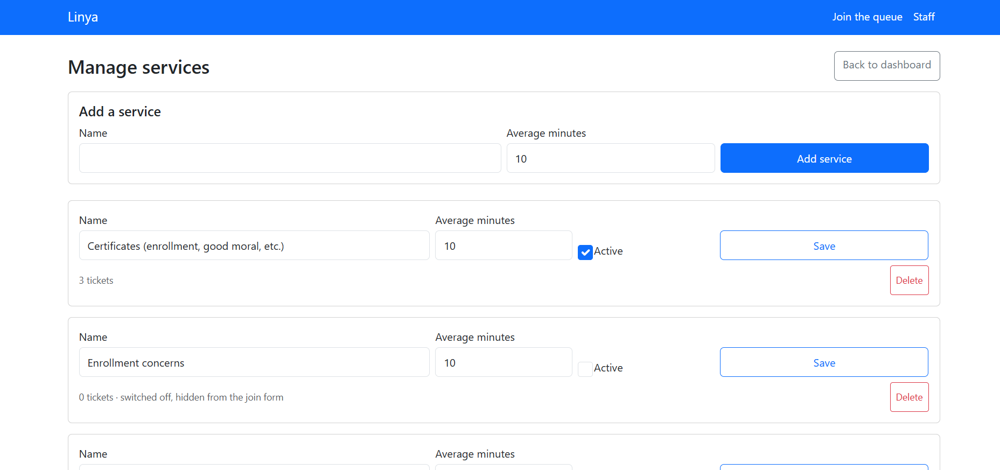
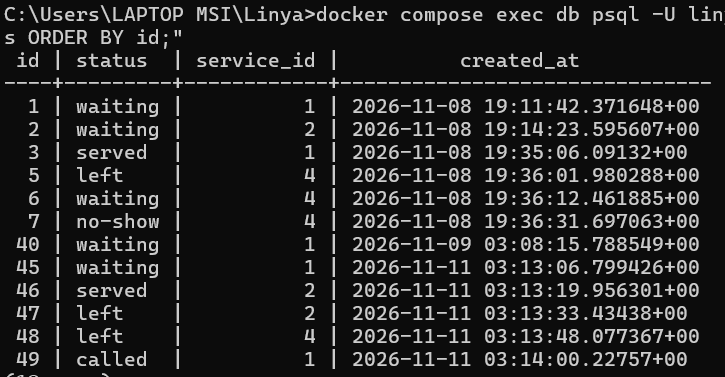
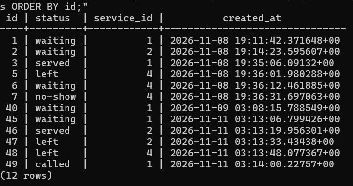

# Linya: Week 4 report

## 1. Title details

| | |
| --- | --- |
| **App** | Linya, a queue system for the campus registrar |
| **Setting** | Campus registrar (Transcript of Records and other requests) |
| **Student** | Winchester Dela Vega |
| **Student ID** | 2024-0673 |
| **Section** | [  ] |
| **Date** | [  ] |
| **Database** | PostgreSQL 17 in Docker (no local fallback) |
| **Pull request** | [paste the PR link] |

## 2. Requirements

I wrote 14 functional requirements (3 marked ★) and 8 non-functional ones in [docs/requirements.md](../requirements.md). My MVP is FR-01, FR-02, FR-03, FR-08, FR-09, FR-10, FR-11 and FR-12, with NFR-05 and NFR-06, because

 [one sentence on why this is the smallest version that still solves the problem].

I checked the list with registrar staff. They said they were confused by the window panel in the staff dashboard . I added an indicator that the window panel is about where students will go to.

## 3. ERD



- One visitor has many tickets.
- One service has many tickets.
- One window has many tickets over a day.
- Each ticket belongs to exactly one visitor and one service, and to at most one window (none until it is called).

Full design: [schema.md](schema.md)

## 4. Schema

```
                                       Table "public.visitors"
   Column   |           Type           | Collation | Nullable |               Default                
------------+--------------------------+-----------+----------+--------------------------------------
 id         | integer                  |           | not null | nextval('visitors_id_seq'::regclass)
 name       | character varying(80)    |           | not null | 
 student_id | character varying(9)     |           |          | 
 created_at | timestamp with time zone |           | not null | now()
Indexes:
    "visitors_pkey" PRIMARY KEY, btree (id)
    "visitors_student_id_key" UNIQUE CONSTRAINT, btree (student_id)
Check constraints:
    "ck_visitors_student_id" CHECK (student_id::text ~ '^[0-9]{4}-[0-9]{4}$'::text)
Referenced by:
    TABLE "tickets" CONSTRAINT "tickets_visitor_id_fkey" FOREIGN KEY (visitor_id) REFERENCES visitors(id) ON DELETE RESTRICT

                                      Table "public.services"
   Column    |         Type          | Collation | Nullable |               Default                
-------------+-----------------------+-----------+----------+--------------------------------------
 id          | integer               |           | not null | nextval('services_id_seq'::regclass)
 name        | character varying(60) |           | not null | 
 avg_minutes | integer               |           | not null | 10
 active      | boolean               |           | not null | true
Indexes:
    "services_pkey" PRIMARY KEY, btree (id)
    "services_name_key" UNIQUE CONSTRAINT, btree (name)
Check constraints:
    "ck_services_avg_minutes" CHECK (avg_minutes > 0)
Referenced by:
    TABLE "tickets" CONSTRAINT "tickets_service_id_fkey" FOREIGN KEY (service_id) REFERENCES services(id) ON DELETE RESTRICT

                            Table "public.windows"
 Column |  Type   | Collation | Nullable |               Default               
--------+---------+-----------+----------+-------------------------------------
 id     | integer |           | not null | nextval('windows_id_seq'::regclass)
 number | integer |           | not null | 
Indexes:
    "windows_pkey" PRIMARY KEY, btree (id)
    "windows_number_key" UNIQUE CONSTRAINT, btree (number)
Check constraints:
    "ck_windows_number" CHECK (number > 0)
Referenced by:
    TABLE "tickets" CONSTRAINT "tickets_window_id_fkey" FOREIGN KEY (window_id) REFERENCES windows(id) ON DELETE RESTRICT

                                       Table "public.tickets"
   Column    |           Type           | Collation | Nullable |               Default               
-------------+--------------------------+-----------+----------+-------------------------------------
 id          | integer                  |           | not null | nextval('tickets_id_seq'::regclass)
 status      | character varying(20)    |           | not null | 'waiting'::character varying
 is_priority | boolean                  |           | not null | false
 created_at  | timestamp with time zone |           | not null | now()
 called_at   | timestamp with time zone |           |          | 
 finished_at | timestamp with time zone |           |          | 
 visitor_id  | integer                  |           | not null | 
 service_id  | integer                  |           | not null | 
 window_id   | integer                  |           |          | 
Indexes:
    "tickets_pkey" PRIMARY KEY, btree (id)
Check constraints:
    "ck_tickets_status" CHECK (status::text = ANY (ARRAY['waiting'::character varying, 'called'::character varying, 'served'::character varying, 'no-show'::character varying, 'left'::character varying]::text[]))
Foreign-key constraints:
    "tickets_service_id_fkey" FOREIGN KEY (service_id) REFERENCES services(id) ON DELETE RESTRICT
    "tickets_visitor_id_fkey" FOREIGN KEY (visitor_id) REFERENCES visitors(id) ON DELETE RESTRICT
    "tickets_window_id_fkey" FOREIGN KEY (window_id) REFERENCES windows(id) ON DELETE RESTRICT
```

## 5. Design decisions

1. **`is_priority` is on `tickets`, not `visitors`,** because a student may be pregnant or injured on one visit and not the next, so the priority lane belongs to a visit (FR-11).
2. **There is no email column, and `student_id` is optional, unique and format-checked.** My Week 1 proposal promises to collect only the minimum data (RA 10173), and nothing in the app needs an email.
3. **Windows have their own table.** Staff pick a window from a list and the student sees "Go to Window N" (FR-08), which also fixed the confusion my usability test found with a free-typed number.
4. **I added `finished_at` to `tickets`** so service time can be computed later (FR-06, FR-14), instead of storing an estimate.

## 6. Self-review

I put my ERD away, then reviewed it against my requirements and my personas using the six review questions. I found four problems.

**No finish time.** FR-06 asks for average service time, but `tickets` only stored when a ticket was created and called. I added `finished_at`, so service time can be computed as `finished_at - called_at`.
**A mistaken ticket left its visitor behind.** FR-13 lets staff hard-delete a ticket, but the visitor's name and student ID would stay with no purpose, against my promise to collect only the minimum data (NFR-03). The delete route now also deletes the visitor when they have no other tickets.
**Visitors without a student ID are never matched.** Without an email, each join creates a new visitor row. I kept the design, because people who give an ID reuse one row and the Week 3 button guard stops double taps, and I noted the limit instead of adding a rule that only works for people with an ID.
**The database cannot check who deserves the priority lane.** That is a policy question, so I made no schema change. The form tells students to show their ID, and the staff dashboard shows a Priority badge so staff can ask for proof.

Full review: [schema-review.md](schema-review.md)

## 7. Migrations

| Migration | What it does |
| --- | --- |
| `073377065ec3_initial_tables.py` | Creates `visitors`, `services`, `windows` and `tickets` with their keys and constraints. |
| `0964db80f7ac_add_services_active.py` | Adds `services.active` (default true) so a service can be switched off without deleting its history. |

I ran `downgrade` then `upgrade` on the second one to check that it can be undone.

## 8. CRUD

| Operation | Route | Requirement | Screenshot |
| --- | --- | --- | --- |
| Create | `POST /join` | FR-01 |  |
| Read | `GET /queue/<id>`, `GET /staff` | FR-02, FR-09 |  |
| Update | `POST /staff/call-next`, `POST /staff/tickets/<id>/serve` | FR-03, FR-08 |  |
| Soft delete | `POST /queue/<id>/leave` (status becomes `left`, row stays) | FR-10 |  |
| Hard delete | `POST /staff/tickets/<id>/delete` | FR-13 |  |
| Manage services | `/staff/services` (create, update, switch off, delete) | FR-12 |  |

Every route that changes data is a POST.

## 9. Validation

I checked the same rules in three places. In the browser, the name field has `maxlength="80"` and the student ID has `maxlength="9"` with a pattern, matching `String(80)` and `String(9)`. In Flask, I sent requests with `curl` that skip the form: an empty name with a bad ID and a missing service, a 200-character name, a malformed ID, and a switched-off service all returned 400 and saved nothing, and a plain GET to the delete route returned 405. In PostgreSQL, I tried nine bad statements directly in psql, and each one was refused: a ticket for a missing service (foreign key), a status of `lost` (check), a duplicate student ID and a duplicate service name (unique), a badly formatted ID and zero minutes (check), a visitor with no name (not null), and deleting a service that has tickets (restrict).

The most useful error was `new row for relation "tickets" violates check constraint "ck_tickets_status"`. It names the exact rule that was broken, and it showed me that even if my Flask code has a bug and sends a wrong status, the database refuses it, so a typo like `lost` can never be saved.

Full results: [validation.md](validation.md)

## 10. Persistence




After `docker compose down` and `up`, every ticket was still there with the same status and time, so NFR-05 passed. I also rebuilt the database from scratch with `down -v`, `up -d`, `db upgrade` and `seed`, and the migrations created all four tables, the seed added my services and windows, and the app let me join the queue. 

Full notes: [persistence.md](persistence.md)

## 11. Reflection

**Hardest this week:** Getting the database running and understanding what each Docker command does. I ran `docker compose down -v` early on, which removed the container and deleted the volume, and then `flask db migrate` hung with no message because there was no database to connect to. It took me a while to see that `docker compose ps` showing nothing was the answer. I also typed SQL into PowerShell by mistake, and had to learn that SQL goes inside psql, or through `psql -c`. A smaller moment was pressing "Leave the queue" on a ticket I had already hard-deleted from the dashboard and getting "Not Found". It showed me that my delete worked, and that a page open in another tab can point at data that no longer exists.


**Hardest requirement to write in a testable way:** The estimated wait in FR-02. "Show an estimated wait" sounds simple, but a number needs real service times, and nothing in my first design recorded when a ticket finished. Finding that gap in my self-review is why I added `finished_at`.

**A report my staff persona would want:** how many people left before being served, per service, per day (FR-14). I will write that query in Week 5.

## 12. Declaration

I used Claude (an AI assistant) to help me install and understand Docker, draft `docs/requirements.md`, `schema.md` and `schema-review.md`, review my design, write and adapt the Docker Compose file, SQLAlchemy models, migrations, seed command, Flask routes, Jinja templates and JavaScript, explain the errors I ran into, suggest the `curl` and psql tests. I decided what my app stores for my setting (no email, an optional student ID, `is_priority` on tickets, a separate windows table), ran every command and test myself, took the screenshots, and checked each piece against my own results. 