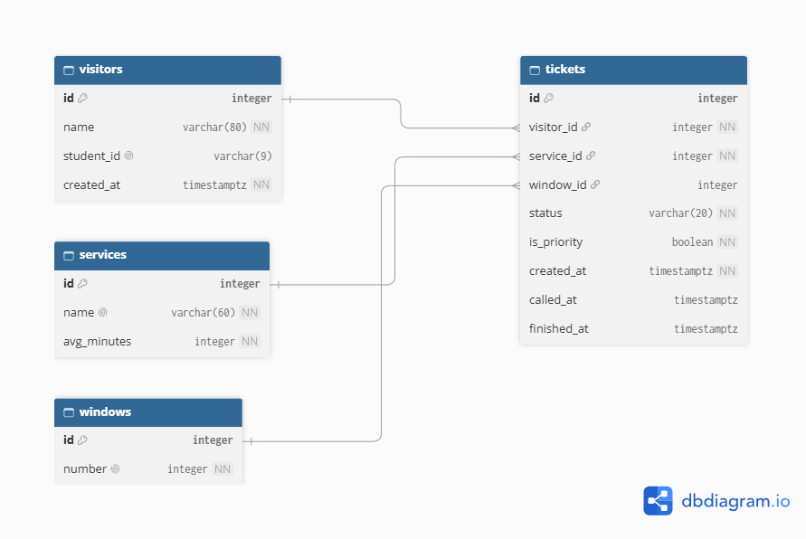

# Linya schema

## 2a. Nouns in my requirements (only rows with Stores data? = Yes)

| Req ID | Requirement | Nouns | Table or column? |
| --- | --- | --- | --- |
| FR-01 | A **student** can join the **queue** for a **transaction type** with a **name** or nickname and an optional **student ID**. | student, queue, transaction type, name, student ID | visitors, *(not a table)*, services, visitors.name, visitors.student_id |
| FR-02 | A student can see their **ticket number**, **status**, how many people are **ahead**, and an **estimated wait**. | ticket number, status, ahead, estimated wait | tickets.id, tickets.status, *(computed)*, *(computed from services.avg_minutes)* |
| FR-03 | Staff can call the next **ticket** and mark it served or no-show, with the **time** it was called. | ticket, time called | tickets, tickets.called_at |
| FR-04 | A student gets an **alert** when their turn is near. | alert | *(no new column: it is the status changing to called)* |
| FR-05 ★ | Staff can issue a **ticket** for a student without a phone. | ticket | tickets *(same table, no new column)* |
| FR-06 | A registrar head can see peak **hours** and average **service time**. | hours, service time | tickets.created_at, *(service time is computed)* |
| FR-08 ★ | Staff assign a **window** when calling. | window | windows, tickets.window_id |
| FR-10 | A student can **leave** the queue. | leave | tickets.status = 'left' *(the row stays)* |
| FR-11 ★ | A student can join a **priority lane**. | priority lane | tickets.is_priority |
| FR-12 | Staff can add, rename, switch off and delete a **service**. | service | services.name, services.active *(added in a second migration)* |
| FR-13 | Staff can delete a mistaken **ticket**. | ticket | a hard delete of a row in tickets |
| FR-14 | Staff can see how many **left** before being served, per service, per day. | left, service, day | tickets.status, tickets.service_id, tickets.created_at *(computed by a query)* |

Two rules I followed: the queue is **not** a table (it is the tickets with status `waiting` for one service, ordered by the time they joined), and I store facts, not results. I store when a ticket was created and compute the position, instead of storing a position.

## 2b. Tables and columns

| Table | Columns |
| --- | --- |
| `visitors` | id, name, student_id (optional), created_at |
| `services` | id, name, avg_minutes |
| `windows` | id, number |
| `tickets` | id, visitor_id, service_id, window_id (empty until called), status, is_priority, created_at, called_at, finished_at |

Where each Week 3 field went:
- **Name and student ID:** facts about the person, so `visitors`.
- **Priority lane:** may change every visit (a student may be pregnant today and not next time), so it is on `tickets`, not `visitors`.
- **Window:** a counter that staff use many times in a day, so its own table.

## 2c. Types and constraints

| Table | Column | PostgreSQL type | Constraint | Why |
| --- | --- | --- | --- | --- |
| visitors | id | integer, generated | PRIMARY KEY | Generated by the database, never reused |
| visitors | name | varchar(80) | NOT NULL | A ticket needs a name to call; matches the form limit |
| visitors | student_id | varchar(9) | UNIQUE, CHECK (student_id ~ '^[0-9]{4}-[0-9]{4}$') | Optional. One visitor per ID, only the YYYY-#### format. PostgreSQL allows many empty (NULL) values in a UNIQUE column |
| visitors | created_at | timestamptz | NOT NULL DEFAULT now() | Time-zone safe; set by the database |
| services | id | integer, generated | PRIMARY KEY | |
| services | name | varchar(60) | NOT NULL UNIQUE | No two services with the same name |
| services | avg_minutes | integer | NOT NULL DEFAULT 10, CHECK (avg_minutes > 0) | For the estimated wait in FR-02 later; rejects impossible values |
| windows | id | integer, generated | PRIMARY KEY | |
| windows | number | integer | NOT NULL UNIQUE, CHECK (number > 0) | Window 1, 2, 3; no duplicates or zero |
| tickets | id | integer, generated | PRIMARY KEY | The ticket number; two people can never get the same one (NFR-06) |
| tickets | visitor_id | integer | NOT NULL, FOREIGN KEY → visitors(id) | No ticket for a missing person |
| tickets | service_id | integer | NOT NULL, FOREIGN KEY → services(id) | No ticket for a missing service |
| tickets | window_id | integer | FOREIGN KEY → windows(id), NULL allowed | Empty until staff call the ticket |
| tickets | status | varchar(20) | NOT NULL DEFAULT 'waiting', CHECK (status IN ('waiting','called','served','no-show','left')) | Only these five statuses |
| tickets | is_priority | boolean | NOT NULL DEFAULT false | True or false, never text |
| tickets | created_at | timestamptz | NOT NULL DEFAULT now() | Gives the order in the queue |
| tickets | called_at | timestamptz | NULL allowed | Empty until the ticket is called |
| tickets | finished_at | timestamptz | NULL allowed | Empty until served or no-show; with called_at it gives the service time |

This uses every constraint type at least once: PRIMARY KEY, FOREIGN KEY, NOT NULL, UNIQUE, CHECK and timestamptz.

## 2d. ERD

Relationships, read aloud:
- One visitor has many tickets. A visitor who comes back later gets a new ticket.
- One service has many tickets.
- One window has many tickets over a day.
- Each ticket belongs to exactly one visitor and one service, and to at most one window (none until it is called).

Delete rules, all **RESTRICT**:
- **visitors → tickets:** deleting a visitor with tickets is blocked, because the registrar needs the history for reports. A later retention job (my Week 1 promise to remove old data) will clear personal fields instead of deleting rows.
- **services → tickets:** a service with tickets cannot be deleted; staff switch it off instead.
- **windows → tickets:** a window that was used cannot be deleted, so old tickets still show where they were served.

## 2e. Normalization

1. **One value per cell (1NF):** yes. No column holds a list. Status holds one word, and student ID holds one ID.
2. **Whole key (2NF):** there are no join tables or composite keys, so every column depends on its single-column key.
3. **No hidden copies (3NF):** a service's name is only in `services`, a window's number is only in `windows`, and a person's name is only in `visitors`. The position in line and the estimated wait are computed, not stored.